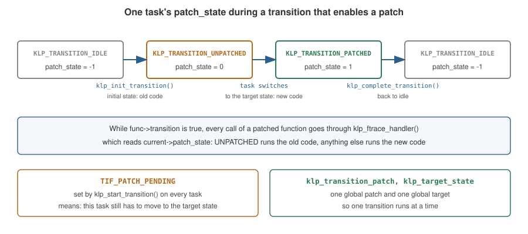
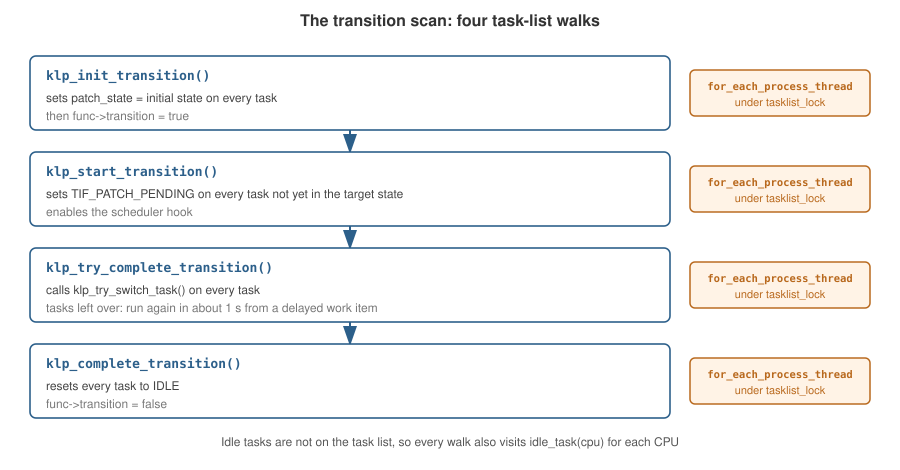
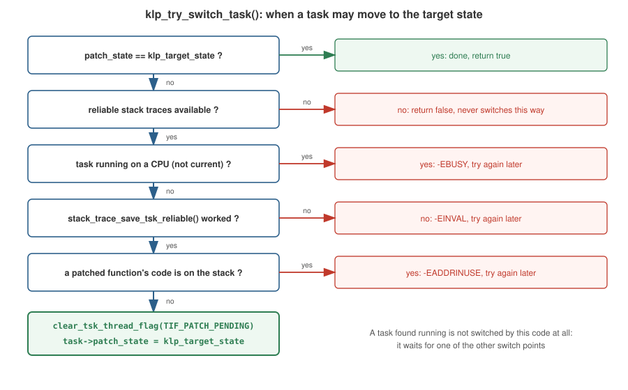
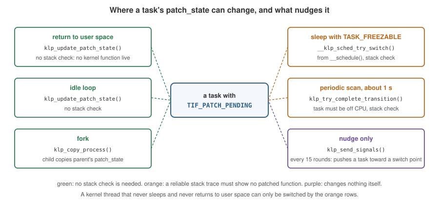
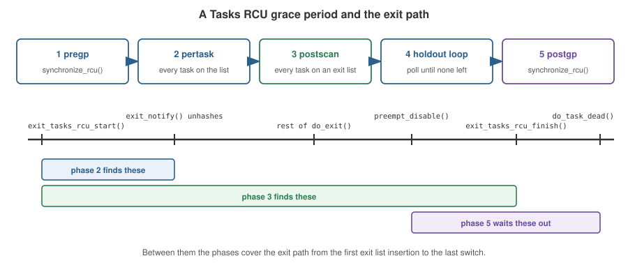
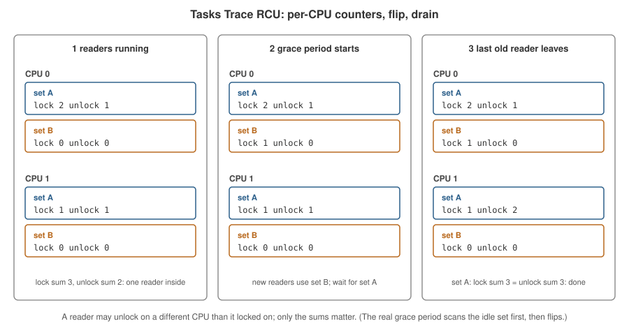
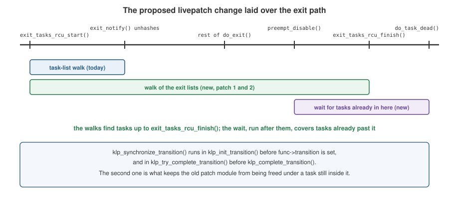

A kernel live patch replaces functions in a running kernel while tasks may be in the middle of calling them. Livepatch handles this with a **transition**: a period during which each task is moved, one at a time, from the old code to the new code when it is safe for that task. A transition has to reach every task, and a task that is exiting can fall outside the places it looks.

RCU (read-copy-update) is a synchronization mechanism in which a writer waits for readers that began earlier. Tasks RCU is a flavor of it, meaning a variant with its own definition of what a reader is, whose grace period waits for every task to pass through a point where it cannot be inside a trampoline. A trampoline is a small piece of generated code that tracing and BPF (a virtual machine inside the kernel) jump through before it is freed. Tasks RCU needs to find every task that might still be running kernel code, which is the same need livepatch has. Its authors solved the exit case with a pair of overlapping windows. A patch series posted to LKML (the Linux Kernel Mailing List) on 2026-11-23 and 2026-11-24 proposes to give livepatch the same protection by reusing the Tasks RCU exit lists.

This post walks through the pieces in order: how a transition scans and switches tasks, what the exit path looks like, how Tasks RCU and Tasks Trace RCU work, and then the series. Code references are to the `next` branch of the RCU tree on 2026-11-24 (`2348d158c7fc`).

## Terms used in this post

- **Task list**: the kernel's list of all processes and threads. Code walks it with `for_each_process_thread()` while holding `tasklist_lock`, the reader-writer lock that protects it.
- **Self-reaping task**: a task whose exit does not wait for a parent to collect it, so the kernel removes it from the task list by itself, inside `exit_notify()`. A task that is not self-reaping is removed when its parent collects it, which can also happen before the task has finished `do_exit()`; the window described below then starts later but ends at the same place.
- **Transition**: the livepatch period during which tasks converge to the new code (when enabling a patch) or back to the old code (when disabling or replacing one).
- **Switch** (a task): set the task's `patch_state` to the target state. A **context switch** is the scheduler replacing the running task on a CPU. This post uses "switch" only for the first and writes "context switch" for the second.
- **Grace period** (Tasks RCU): the wait until every task has done something that proves it is not inside the protected code.

## 1. What a livepatch transition is

Every task has a field `patch_state`. It takes one of three values, defined in `include/linux/livepatch.h`:

| value | name | meaning |
|---|---|---|
| -1 | `KLP_TRANSITION_IDLE` | no transition in progress for this task |
| 0 | `KLP_TRANSITION_UNPATCHED` | the task uses the old code |
| 1 | `KLP_TRANSITION_PATCHED` | the task uses the new code |

Two globals describe the transition itself: `klp_transition_patch` (the patch being applied) and `klp_target_state` (where tasks are heading). Because both are single variables, one transition runs at a time. The diagram shows enabling a patch; for disabling, the roles of `UNPATCHED` and `PATCHED` swap.

<a href="/images/livepatch-rcu/states.svg">transition is true, klp_ftrace_handler picks old or new code from the calling task's patch_state." loading="lazy" style="width:100%;max-width:100%"></a>

What makes this work is the handler that every patched function goes through. Livepatch hooks each patched function with ftrace, the kernel's function-entry hook, and while `func->transition` is true the handler reads the calling task's `patch_state`: a task in `UNPATCHED` runs the old function and any other state runs the new one (`kernel/livepatch/patch.c`, `klp_ftrace_handler()`). Moving a task from state 0 to state 1 is therefore the moment that task starts running the new code.

A small example. A patch replaces `foo()`. Three tasks exist when the patch is enabled: task X sleeping inside `foo()`, task Y running in user space, task Z a kernel thread that never calls `foo()`. `klp_init_transition()` sets all three to `UNPATCHED`. `klp_start_transition()` marks all three with `TIF_PATCH_PENDING` (TIF stands for thread info flag), meaning "this task still has to move to the target state". Y switches on its next return from the kernel. Z is checked by the scanner and switches, when it is off CPU, because `foo()` is not on its stack. X cannot switch while `foo()` is on its stack, so it keeps using the old `foo()` until it leaves it. The transition completes only after X has also switched.

## 2. The transition scan

A transition is driven by four functions, and each of them walks the task list under `tasklist_lock`:

<a href="/images/livepatch-rcu/scan.svg">transition true; klp_start_transition sets TIF_PATCH_PENDING on every task; klp_try_complete_transition calls klp_try_switch_task on every task and runs again in about one second if tasks are left; klp_complete_transition resets every task to IDLE. Each box is tagged for_each_process_thread under tasklist_lock." loading="lazy" style="width:100%;max-width:100%"></a>

The first walk is representative (`klp_init_transition()` in `kernel/livepatch/transition.c`):

```c
read_lock(&tasklist_lock);
for_each_process_thread(g, task) {
	WARN_ON_ONCE(task->patch_state != KLP_TRANSITION_IDLE);
	task->patch_state = initial_state;
}
read_unlock(&tasklist_lock);
```

The idle tasks, one per CPU, are not on the task list, so each function also loops over `idle_task(cpu)` separately.

When `klp_try_complete_transition()` finds a task it cannot switch, it schedules itself again with `schedule_delayed_work(&klp_transition_work, round_jiffies_relative(HZ))`. A jiffy is one timer tick and `HZ` is the number of ticks per second, so `HZ` jiffies is one second. `round_jiffies_relative()` moves the expiry to a whole-second boundary so that timers on different CPUs fire together, which is why the retry is "about" once a second. Every `SIGNALS_TIMEOUT` rounds, defined as 15, it also calls `klp_send_signals()`, which wakes kernel threads and sends a fake signal to user tasks to push them through a kernel exit. Fifteen failed rounds is roughly fifteen seconds, which matches `Documentation/livepatch/livepatch.rst`: "The fake signal is automatically sent every 15 seconds."

`klp_synchronize_transition()` appears in the code that follows, so here is what it does. It is `schedule_on_each_cpu()` with an empty work function: it returns after a work item has run on every online CPU, which requires every CPU to context switch. Livepatch uses it instead of `synchronize_rcu()` because patched functions may run where RCU is not watching, for example before `user_exit()`; the comment above it in the source says "We can not rely on the RCU infrastructure to do the synchronization. Instead hard force the sched synchronization." `klp_complete_transition()` already calls it once. When disabling, it calls it after unpatching the functions, so `klp_ftrace_handler()` has stopped seeing removed functions before `func->transition` is cleared. When enabling, it calls it after clearing `func->transition`, so the handler never sees `KLP_TRANSITION_IDLE`.

## 3. The switch code

The decision for one task is `klp_try_switch_task()`. It ends in two small functions. `klp_check_and_switch_task()` is the core (abridged to the lines that decide):

```c
if (task_curr(task) && task != current)
	return -EBUSY;

ret = klp_check_stack(task, arg);
if (ret)
	return ret;

clear_tsk_thread_flag(task, TIF_PATCH_PENDING);
task->patch_state = klp_target_state;
return 0;
```

<a href="/images/livepatch-rcu/switch.svg"></a>

Two details matter for what follows.

**The scanner never switches a task that is running on a CPU.** `task_curr()` is true for a task currently on a CPU, and the scanner returns `-EBUSY`. The switch happens through one of the other switch points below, or on a later scan when the task is off CPU. The call is wrapped in `task_call_func()` so that the task cannot start running while its stack is being examined.

**The stack check uses a reliable stack trace.** `klp_check_stack()` calls `stack_trace_save_tsk_reliable()`, which either returns every return address on the task's stack or fails; it never returns a partial answer (`Documentation/livepatch/reliable-stacktrace.rst`). It saves into a per-CPU buffer of `MAX_STACK_ENTRIES`, defined as 100, return addresses; the source gives no reason for 100, and a stack of 100 or more entries fills the buffer and makes the trace fail, which the task reports as `-EINVAL` and does not switch. Then, for each function the patch touches, it asks whether any saved address falls inside that function's code. If one does, the task is sitting inside a function that is about to change, and the result is `-EADDRINUSE`.

## 4. Where a task gets switched

The scanner is one of several ways a task moves to the target state:

<a href="/images/livepatch-rcu/points.svg"></a>

Returning to user space needs no stack check. `kernel/entry/common.c` calls `klp_update_patch_state(current)` when `_TIF_PATCH_PENDING` is set, because a task that has left the kernel has no kernel function live on its stack. The idle loop does the same. A forked child copies its parent's `patch_state` in `klp_copy_process()`, serialized against transitions by `tasklist_lock`.

The scheduler hook, `__klp_sched_try_switch()`, comes from commit `676e8cf70cb0`, "sched,livepatch: Untangle cond_resched() and live-patching". It is called from `__schedule()` through this wrapper (`include/linux/livepatch_sched.h`):

```c
if (static_branch_unlikely(&klp_sched_try_switch_key) &&
    READ_ONCE(curr->__state) & TASK_FREEZABLE)
	__klp_sched_try_switch();
```

It fires when the outgoing task is going to sleep with `TASK_FREEZABLE` set, not when the task is merely preempted, since a preempted task is still runnable. The commit message gives the goal as stopping livepatch from relying on `cond_resched()` to make forward progress and relying on `schedule()` with `TASK_FREEZABLE` set instead: "Just like live-patching, the freezer needs to be able to stop tasks in a safe / known state." A kernel thread that never sleeps and is only ever preempted is handled by the scanner when it happens to be off CPU, and otherwise has to wait.

## 5. The exit path, and the tasks a scan cannot see

Now the part that connects livepatch to RCU. It is easiest to start with the incident that exposed it. On 2025-01-21 Yafang Shao [reported a panic on production servers](https://lore.kernel.org/live-patching/CALOAHbA9WHPjeZKUcUkwULagQjTMfqAdAg%2BakqPzbZ7Byc%3Dqrw%40mail.gmail.com/) running Linux 6.1.52. A livepatch `livepatch_61_release6` had been replaced by `livepatch_61_release12`, and both patched `do_exit()`. A task faulted at `do_exit+1818`, an address inside the old module, which had already been unloaded. The instruction at that offset is the one immediately after the call to `release_task()`. It happened on four servers out of about 50,000, always at that point. The crash site and the unloaded module are in the report; the mechanism below is the explanation the later series adopts. The task had been removed from the task list by `release_task()`, so the transition could not see it; the transition completed, the old module was freed, and the task returned into it.

This is the order of operations in `do_exit()` (`kernel/exit.c`), shortened:

```c
exit_tasks_rcu_start();
exit_notify(tsk, group_dead);
proc_exit_connector(tsk);
...
preempt_disable();
...
exit_rcu();
exit_tasks_rcu_finish();

lockdep_free_task(tsk);
do_task_dead();
```

`exit_notify()` takes `tasklist_lock` for writing. For a self-reaping task it marks the task `EXIT_DEAD` and calls `release_task()`, which ends in `__unhash_process()` and removes the task from the task list with `list_del_rcu()`. After that point `for_each_process_thread()` cannot find the task.

But the task is not finished. It still runs the rest of `do_exit()`, can be preempted and can take interrupts, and stops only at its last `__schedule()` inside `do_task_dead()`.

<a href="/images/livepatch-rcu/exitwin.svg"></a>

Every livepatch walk in section 2 uses `for_each_process_thread()`. A task between `exit_notify()` and `do_task_dead()`, the stretch labeled "invisible to for_each_process_thread" in the diagram, never gets `patch_state = initial_state`, never gets `TIF_PATCH_PENDING`, and is never stack checked. Its `patch_state` stays at whatever it was, usually `KLP_TRANSITION_IDLE`. The ftrace handler warns on that state and falls through to the new function, because only `UNPATCHED` selects the old one. That is a task running new code without having been transitioned.

The worse case is disabling or replacing a patch, as in the crash above. Once the transition is judged complete, the old patch module can be freed, and a task still in that stretch, inside a function from that module or about to return into it, executes freed memory. `kernel/livepatch/` at this tree contains no use of `exit_tasks_rcu_*`, `synchronize_rcu_tasks*`, or any list of exiting tasks; the only exit-related code there is `klp_copy_process()` for fork. After the 2025 report, Petr Mladek and Josh Poimboeuf discussed approaches. [Josh asked](https://lore.kernel.org/live-patching/20250124010848.pdcxokfsk2ngrowl@jpoimboe/) whether livepatch could keep a list of exiting tasks, noted that Tasks RCU already keeps something like it in `exit_tasks_rcu_start()`, and suggested reusing the same list.

## 6. How Tasks RCU covers the same path

A Tasks RCU grace period runs in five phases, driven by `rcu_tasks_wait_gp()` in `kernel/rcu/tasks.h`:

<a href="/images/livepatch-rcu/tasksrcu.svg"></a>

1. **pregp** calls `synchronize_rcu()` so earlier scheduler state is visible.
2. **pertask** walks every non-idle task and puts the ones that might still be inside the protected code on a **holdout** list (the tasks the grace period is still waiting for).
3. **postscan** walks the per-CPU **exit lists** and adds those tasks to the holdout list as well.
4. The **holdout loop** polls the list until it is empty.
5. **postgp** calls `synchronize_rcu()` once more.

The exit lists and the last `synchronize_rcu()` exist for the exit path. The comment in `rcu_tasks_postscan()` states the design:

```c
/*
 * Exiting tasks may escape the tasklist scan. Those are vulnerable
 * until their final schedule() with TASK_DEAD state. To cope with
 * this, divide the fragile exit path part in two intersecting
 * read side critical sections:
 *
 * 1) A task_struct list addition before calling exit_notify(),
 *    which may remove the task from the tasklist, with the
 *    removal after the final preempt_disable() call in do_exit().
 *
 * 2) An _RCU_ read side starting with the final preempt_disable()
 *    call in do_exit() and ending with the final call to schedule()
 *    with TASK_DEAD state.
 *
 * This handles the part 1). And postgp will handle part 2) with a
 * call to synchronize_rcu().
 */
```

`exit_tasks_rcu_start()` puts the task on a per-CPU list before `exit_notify()` can unhash it. `exit_tasks_rcu_finish()` removes it after `do_exit()` has become non-preemptible, with the comment "allowing synchronize_rcu() to wait beyond this point". The two windows overlap, so no instant of the exit path is uncovered. Window 1 runs from `exit_tasks_rcu_start()` to `exit_tasks_rcu_finish()` and is found by postscan. Window 2 runs from the last `preempt_disable()` to the last schedule. Nothing can preempt the task there, and a region with preemption disabled counts as an RCU read-side critical section: `synchronize_rcu()` returns only after every such region that was running when it began has ended, which for this tail means after the task's last context switch.

## 7. How Tasks Trace RCU works

Tasks Trace RCU is the other Tasks flavor. It avoids this problem by a different design: it never walks the task list. In this tree (`include/linux/rcupdate_trace.h`) it is a thin layer over SRCU-fast. SRCU is sleepable RCU, whose readers may block, and SRCU-fast is the reader flavor whose lock and unlock are per-CPU counter increments without a memory barrier; the grace period supplies the ordering by calling `synchronize_rcu()` (or its expedited form). Tasks Trace adds an `smp_mb()` on top unless `CONFIG_TASKS_TRACE_RCU_NO_MB` is set, which is the default on architectures that mark their entry code `noinstr`. A Tasks Trace reader marks itself explicitly:

```c
static inline void rcu_read_lock_trace(void)
{
	int n;
	struct task_struct *t = current;

	rcu_try_lock_acquire(&rcu_tasks_trace_srcu_struct.dep_map);
	n = READ_ONCE(t->trc_reader_nesting);
	WRITE_ONCE(t->trc_reader_nesting, n + 1);
	if (n) {
		// In case we interrupted a Tasks Trace RCU reader.
		return;
	}
	barrier();  // nesting before scp to protect against interrupt handler.
	t->trc_reader_scp = __srcu_read_lock_fast(&rcu_tasks_trace_srcu_struct);
	if (!IS_ENABLED(CONFIG_TASKS_TRACE_RCU_NO_MB))
		smp_mb(); // Placeholder for more selective ordering
}
```

`trc_reader_nesting` lets readers nest without extra counter traffic. The first level increments a per-CPU **lock** counter. Unlocking increments a per-CPU **unlock** counter, possibly on a different CPU if the task migrated. `synchronize_rcu_tasks_trace()` is `synchronize_srcu()` on that structure.

<a href="/images/livepatch-rcu/trace.svg"></a>

Take two CPUs. In panel 1, set A has CPU 0 at lock 2, unlock 1 and CPU 1 at lock 1, unlock 1. The lock sum is 3 and the unlock sum is 2, so one reader that began before the grace period is still inside. When a grace period starts, new readers use set B. (The real grace period first scans the idle set and then flips; the diagram skips that step.) The grace period waits until set A's lock sum equals its unlock sum. In panel 3 the old reader finishes and unlocks on CPU 1: set A is now lock 3, unlock 3, and the grace period ends. Only the sums over all CPUs matter, so the reader may unlock somewhere other than where it locked.

Two properties follow from this design. A task inside a reader is counted by the counters whether or not it is on the task list, so exit does not create a blind spot. And a reader may be preempted or may block, which is why BPF programs that can sleep use it. The price is that every protected region must be wrapped in explicit `rcu_read_lock_trace()` and unlock calls. That is workable for trampolines, which are few and known. Livepatch asks a different question, whether a function that is about to be replaced is on a task's stack. Any kernel function can be patched, so there is no fixed region to wrap in a reader.

## 8. The proposed livepatch change

[Binoy Ravindran's series, "livepatch: Do not lose exiting tasks during a transition"](https://lore.kernel.org/all/20261124-klp-series-v3-v2-0-50d20829a337@vt.edu/) (v2, 2026-11-24; [v1](https://lore.kernel.org/all/20261123-klp-series-v3-v1-0-427c95811d9b@vt.edu/), 2026-11-23), has three patches and takes up Josh's 2025 suggestion directly. Its cover letter cites [Yafang's 2025 hybrid-mode RFC](https://lore.kernel.org/all/20250127063526.76687-1-laoar.shao@gmail.com/) as the place the race was discussed.

1. [rcu-tasks: Add helpers to visit tasks on the exit lists](https://lore.kernel.org/all/20261124-klp-series-v3-v2-1-50d20829a337@vt.edu/). It adds `rcu_tasks_visit_exiting()`, which calls a function on each task on the exit lists under the list locks, and `rcu_tasks_snapshot_exiting()`, which copies the tasks into a caller-supplied array with a reference held on each, for callers that must sleep. It also moves the cursor that `rcu_tasks_postscan()` keeps in a list (a bare `list_head` on its stack) into `struct rcu_tasks_percpu`, as `rtp_exit_cursor`, so the new helpers can recognize and skip it.
2. [livepatch: Include exiting tasks in the transition](https://lore.kernel.org/all/20261124-klp-series-v3-v2-2-50d20829a337@vt.edu/). Every step of a transition now also visits the exit lists. `klp_init_transition()`, `klp_start_transition()`, `klp_complete_transition()` and the reverse and force paths walk them in place under `tasklist_lock` and skip tasks that are still hashed, so each task is visited once. `klp_try_complete_transition()` may inspect a stack, so it takes a snapshot with a reference on each task, sized as the count at that moment plus 64 entries of slack for tasks that start exiting before the copy. The 64 is a constant in the patch with no other derivation. Past that, or if the snapshot cannot be allocated, the transition is treated as incomplete and runs again after about a second. The patch also calls `klp_synchronize_transition()` in two places: in `klp_init_transition()`, before `func->transition` is set, and in `klp_try_complete_transition()`, before `klp_complete_transition()`. It carries `Fixes: d83a7cb375ee` (the per-task consistency model).
3. [livepatch: Select TASKS_RCU](https://lore.kernel.org/all/20261124-klp-series-v3-v2-3-50d20829a337@vt.edu/), suggested by Yafang Shao. The exit lists exist only with `CONFIG_TASKS_RCU`. The commit message argues that every kernel that can enable livepatch already builds it: livepatch depends on dynamic ftrace, which selects the need for Tasks RCU, `TASKS_RCU` defaults on when preemption is configured, and every architecture that supports livepatch also selects `ARCH_HAS_PREEMPT_LAZY`, which rules out voluntary preemption, and none selects `ARCH_NO_PREEMPT`, which no-preemption requires, so preemption is always configured. The patch makes that dependency explicit and changes no configuration today.

<a href="/images/livepatch-rcu/fix.svg"></a>

The structure is the same two overlapping parts as in Tasks RCU, with a different tool for the second part. The exit-list walk covers window 1. The wait covers window 2, using `klp_synchronize_transition()` from section 2: a task in the final non-preemptible stretch cannot be preempted, and the next context switch on its CPU is its last, so any task in that stretch has made its last context switch by the time the call returns.

The walks run before the wait, which closes the gap. The walks of the task list (first, so a task unhashed after that walk was already on an exit list or had passed `exit_tasks_rcu_finish()`) and of the exit lists run first; the wait runs after them, once in `klp_init_transition()` and once in `klp_try_complete_transition()`. A task the walks did not find had already passed `exit_tasks_rcu_finish()`, so when the wait begins it is in the non-preemptible tail or finished, and the wait returns only after its last context switch. A task that enters the tail after the wait began was visited by the walks: `klp_init_transition()` gave it a `patch_state`, and `klp_try_complete_transition()` completes only once every visited task has switched. Between `preempt_disable()` and `do_task_dead()` the sequence in section 5 contains `exit_rcu()`, `exit_tasks_rcu_finish()` and `lockdep_free_task()`, and none of them sleeps: `exit_tasks_rcu_finish()` takes a raw spinlock with interrupts off, `lockdep_free_task()` is an empty inline in this tree, and `exit_rcu()` only calls `__rcu_read_unlock()` and the deferred quiescent-state check. Without `CONFIG_TASKS_RCU` the exit lists do not exist and only the tail wait remains, which is why patch 3 selects it. The cost is two extra `schedule_on_each_cpu()` calls per transition.

**Test results quoted in the cover letter (v2, retested on v7.4-rc2).** The tests ran on x86-64 in a virtual machine (QEMU with KVM, the Linux hardware-virtualization interface). Two livepatches built with `klp-build` (the in-tree tool that builds a livepatch module from a source diff) each replace `do_exit()` and replace each other ten times per run, with a debug-only 2 second sleep after `exit_notify()` to widen the window. Twelve runs of ten replacements is 120 replace cycles. Without the series, 9 of 12 runs crashed executing freed module memory. With it, all 12 completed their 120 cycles. With lockdep (the kernel's lock-order checker), `CONFIG_PROVE_RCU` (which checks RCU usage rules) and `CONFIG_DEBUG_ATOMIC_SLEEP` (which warns when code sleeps while preemption is disabled) enabled, the series ran 180 replace cycles, 120 of them with the sleep, and produced no reports. That last option matters here because the argument above depends on the tail of `do_exit()` not sleeping. Without the sleep, the cover letter reports 20,000 replace cycles with the series, in both the default and `preempt=full` modes (the boot parameter that selects full kernel preemption on a `PREEMPT_DYNAMIC` kernel), with no fault and transition times unchanged: medians of 7 to 9 ms and 90th percentiles of about 1.5 s. Those timings include the two extra `schedule_on_each_cpu()` calls.

**Review so far.** The kernel.org AI patch-review bot (Sashiko) [found two issues in v1](https://lore.kernel.org/all/sashiko-outbox-230067@kernel.org/). First, a task that is on both the task list and an exit list can switch between the two walks of `klp_start_transition()` and then have `TIF_PATCH_PENDING` set again, which trips a `WARN_ON_ONCE` in `klp_complete_transition()`; v2 walks the exit lists under `tasklist_lock` and skips tasks that are still hashed, so each task is visited once. Second, a task past `exit_tasks_rcu_finish()` but not yet dead is on neither walk; v2 added the `klp_synchronize_transition()` calls for it. [Yafang Shao replied](https://lore.kernel.org/all/CALOAHbDu5NmVowk4SHzeUDxASaxKkbL_w1dModFWzdi8yK9tBw%40mail.gmail.com/) that the exit list alone narrows the window without closing it, and asked how the synchronize call closes the rest; she also asked whether a separate list is needed, and Binoy answered that the exit lists already cover the window. [Binoy's answer](https://lore.kernel.org/all/DM6PR05MB41377901DA5182DDFAD6E3D4D1442@DM6PR05MB4137.namprd05.prod.outlook.com/) has four steps:

1. Until `exit_tasks_rcu_finish()` the task is on the task list, an exit list, or both. After it, possibly neither.
2. `do_exit()` calls `preempt_disable()` before `exit_tasks_rcu_finish()`, so from then on the task cannot sleep, be preempted or migrate.
3. `klp_synchronize_transition()` returns only after a work item has run on every online CPU, so every CPU has context switched, and any task in that gap has made its last context switch.
4. So call it in `klp_init_transition()` and before `klp_complete_transition()`.

He also states the limit: the exit lists exist only with `CONFIG_TASKS_RCU`, and without it only the final non-preemptible stretch is covered, which is the reason for patch 3. [Yafang replied](https://lore.kernel.org/all/CALOAHbCDSAuvxHt2jd-f5rvTrxeZ4KZkKUfqxrE09PXk%2BTe36Q%40mail.gmail.com/) that the explanation makes sense and proposed the `select TASKS_RCU` change that became patch 3.

As of 2026-11-24 the series is not merged, and the thread has no replies from the livepatch or RCU maintainers yet.

## Sources

- `kernel/livepatch/transition.c`, `kernel/livepatch/core.c`, `kernel/livepatch/patch.c`, `include/linux/livepatch.h`, `include/linux/livepatch_sched.h`, `Documentation/livepatch/livepatch.rst` and `reliable-stacktrace.rst`
- `kernel/exit.c` (`do_exit()`, `exit_notify()`, `__unhash_process()`), `kernel/entry/common.c`
- `kernel/rcu/tasks.h` (`rcu_tasks_wait_gp()`, `rcu_tasks_postscan()`, `exit_tasks_rcu_start()`, `exit_tasks_rcu_finish()`), `include/linux/rcupdate_trace.h`
- Commit `676e8cf70cb0`, "sched,livepatch: Untangle cond_resched() and live-patching"
- LKML: [the v2 series](https://lore.kernel.org/all/20261124-klp-series-v3-v2-0-50d20829a337@vt.edu/), [Yafang Shao's 2025 crash report](https://lore.kernel.org/live-patching/CALOAHbA9WHPjeZKUcUkwULagQjTMfqAdAg%2BakqPzbZ7Byc%3Dqrw%40mail.gmail.com/), [Yafang Shao's 2025 hybrid-mode RFC](https://lore.kernel.org/all/20250127063526.76687-1-laoar.shao@gmail.com/), [Josh Poimboeuf's exit-list suggestion](https://lore.kernel.org/live-patching/20250124010848.pdcxokfsk2ngrowl@jpoimboe/)

Corrections are welcome.
